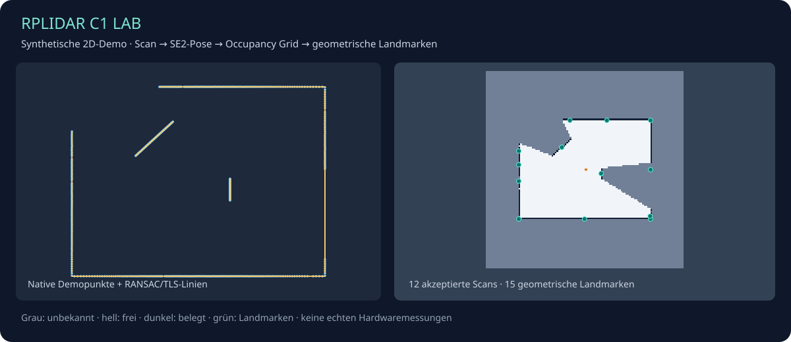
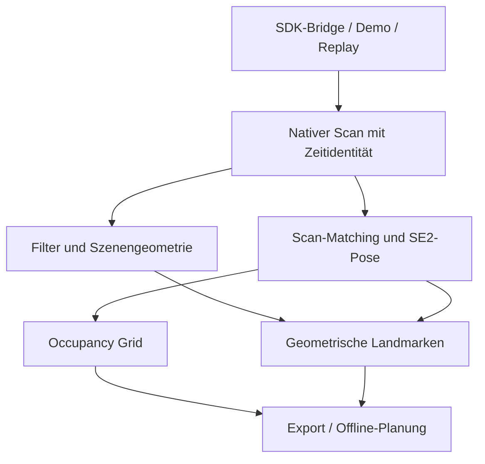

<div align="center">

# SLAMTEC RPLIDAR C1 Lab

**Vom nativen Laserscan zur vermessbaren Szene, 2D-Karte und geometrischen Landmarke.**

[](https://github.com/CagriCatik/SLAMTEC-RPLIDAR-C1/actions/workflows/ci.yml)
[](pyproject.toml)
[](pyproject.toml)
[](LICENSE)
[](docs/hardware-validation.md)

[**Einrichtung**](docs/setup.md) · [**16 Projekte**](TUTORIAL_INDEX.md) · [**Funktionsmatrix**](docs/capabilities.md) · [**Quellen**](docs/sources.md)

</div>



Ein nachvollziehbares Python-/C++-Labor für den **RPLIDAR C1M1-R2**. Native Messwerte bleiben erhalten. Hardware, synthetische Szenen und Replay verwenden dieselbe Auswertung. Der Kern benötigt NumPy; Matplotlib und ROS sind optionale Adapter.

| Stufe | Tatsächlich implementiert | Nachweis |
|---|---|---|
| **V1 · Szeneninspektor** | Polar-/Kartesisch-Viewer, Filter, Cluster, Linien/Ecken, Sektoren, Punktmessung, Referenzvergleich | Numerik/Replay geprüft; echte Hardware offen |
| **V2 · Mobiler Raumscanner** | Lokales SE(2)-Scan-Matching, Poseverkettung, Occupancy Grid, Trackingverlust | Synthetische Sollposen und Fehlerfälle geprüft |
| **V3 · Landmarkenkarte** | Geometrische Linien-/Ecken-/Cluster-Hypothesen, IDs, Quellenbezug, Abfrage und Export | Synthetische Wiederbeobachtung geprüft |
| **V4 · Offline-Vorbereitung** | Kreisförmiger Footprint, konservative Inflation und A* auf gespeicherten Karten | Grid-/Pfadtests; keine Robotersteuerung |
| **Gerätezugang** | Eigene C++-Bridge zum offiziellen SDK, Diagnose, Modi, Scans und Cleanup | Gegen gepinntes SDK unter Linux gebaut; Hardware offen |
| **ROS 2 / SLAM** | Offizieller C1-Treiber und SLAM-Toolbox-Einstieg | Syntax/API-Abgleich; Laufzeit/TF/Odometrie offen |

## Schnellstart ohne Sensor

```bash
git clone https://github.com/CagriCatik/SLAMTEC-RPLIDAR-C1.git
cd SLAMTEC-RPLIDAR-C1
python3 -m venv .venv
source .venv/bin/activate
python -m pip install -e .

c1-lab scene --output recordings/scene-001
c1-lab map --scans 12 --output recordings/map-001
c1-lab landmarks --input recordings/map-001/landmarks.json --confirmed
c1-lab map --source replay --input recordings/map-001 --scans 12 --output recordings/replay-001
```

Die Demo erzeugt Messungen aus bekannten 2D-Segmenten. Ihre Sollposen werden dem Mapper nicht übergeben. Der Demolauf enthält keine echten C1-Messungen. Pro Versuch einen neuen Ausgabenamen verwenden.

## Mit deinem C1M1-R2

Referenzziel: Ubuntu 24.04 / Python 3.12. Linux-Bridge mit `git`, `make` und `g++` bauen:

```bash
python scripts/build_bridge.py
c1-lab inspect --port /dev/ttyUSB0
c1-lab capture --source hardware --port /dev/ttyUSB0 --scans 100 --output recordings/c1-001
```

Der Build lädt bei Bedarf die dokumentierte offizielle SDK-Revision; Lizenz und Buildstand landen neben dem Binary. `inspect` startet keinen Scanmotor. Die Scan-Bridge verlangt gesunden Gerätestatus, eine C1-Modellbeschreibung und einen tatsächlich angebotenen Modus. Das bestätigt die C1-Familie; die genaue R2-Revision ist am Typenschild/Handbuch zu prüfen. Zugriff über passenden USB-/UART-Adapter und Zugriffsregeln einrichten. Die Anwendung ändert keine Firmware oder dauerhafte Kalibrierung.

## Anzeigen und messen

```bash
python -m pip install -e '.[viewer]'
c1-lab view --source demo --scans 30
c1-lab view --source hardware --polar --scans 100
c1-lab measure --input recordings/c1-001/scan_000000.npz --indices 10 20
c1-lab scene --source replay --input recordings/c1-001 --output recordings/c1-scene-001
c1-lab scene --source replay --input recordings/c1-001 --baseline recordings/c1-scene-001/scene.json
```

`measure` verwendet zwei gültige native Messpunktindizes desselben Scans. Der Viewer zeichnet Polar- oder kartesische Daten sowie geometrische Linien. Ein rotierender Scan ist keine simultane Momentaufnahme. Referenzvergleiche setzen eine unveränderte Sensorpose voraus.

## Karte, Landmarken und Offline-Planung

```bash
c1-lab map --source hardware --scans 300 --config configs/default.json --output recordings/live-map-001 --preview
c1-lab plan --input recordings/map-001/grid.npz --start .5 .5 --goal 2 2 --radius .2 --output artifacts/plan-001.json
```

Die Voxel-/RGB-D-Bausteine des RealSense-Projekts werden hier fachlich durch 2D-Strahlen und ein Occupancy Grid ersetzt. Die Planung ist ein Offline-Ergebnis, kein Fahrbefehl. Start/Ziel und der ganze kreisförmige Footprint müssen in bekannten freien Zellen liegen.

| Datei | Bedeutung |
|---|---|
| `scan_*.npz` | Scan-Schema 1; Winkel, Distanz, Status und verfügbare native Arrays/Zeitmetadaten |
| `tracking.jsonl`, `trajectory.json` | Posen und Qualitäts-/Fehlerstatus |
| `grid.npz` | Log-Odds, beobachtete Zellen und abgeleitete Zustände |
| `map.pgm`, `map.yaml` | Trinary-Kartenexport mit dokumentiertem Ursprung und Y-Ausrichtung |
| `landmarks.json`, `landmarks.csv` | Geometrische Sitzungs-IDs, Position, Streuung und jüngere Belege |
| `landmark-observations.jsonl` | Vollständige Beobachtungen/Ablehnungen mit Pose und Scan-Fingerabdruck |

## Architektur



## Mess- und Prüfgrenzen

- Meter/Radiant/Sekunden, x vorwärts/y links, positive Drehung gegen den Uhrzeigersinn. Die Karte beginnt im ersten Sensorframe.
- **UNKNOWN, HIT und ausdrücklich bestätigtes CLEAR sind getrennt.** Die SDK-Bridge erzeugt aus fehlenden Rückgaben niemals CLEAR. Auch der ungemessene Nahbereich bleibt unbekannt.
- Native Winkelwerte, Viertelmillimeter-Distanzen, Qualitätsbyte und Flags bleiben in Hardwareaufnahmen erhalten. Qualität ist keine kalibrierte Reflektivität.
- SDK-Zeiten sind hier Host-Empfangszeiten. Keine präzise Punktzeit, Bewegungsentzerrung, eingebaute IMU oder Höhenmessung wird behauptet.
- Lokale Odometrie hat Drift und keine Loop Closure. Bei erkanntem Verlust werden Karte und Landmarken nicht weiter fusioniert.
- Landmarken sind geometrische Hypothesen, keine Objektklassen. `confirmed` bedeutet mehrfach zugeordnet, keine bewiesene Identität.
- SDK-/Bridge-Build und Softwaretests ersetzen weder Geräte-, Genauigkeits-, ROS- noch Navigationsabnahme.

## Dokumentation und Entwicklung

| Dokument | Inhalt |
|---|---|
| [Einrichtung](docs/setup.md) | Betriebssystem, USB/UART, SDK, Python und Viewer |
| [Daten und Architektur](docs/architecture.md) | Einheiten, Formate, Module und Fehlerverhalten |
| [CLI und Anwendungen](docs/applications.md) | V1–V4, Filter, Replay und Exporte |
| [Spezifikation/Quellen](docs/sources.md) | Revisionen, Herstellerwerte und überprüfte Commits |
| [Funktionsmatrix](docs/capabilities.md) | Implementierung / Software / Integration / Hardware |
| [Hardware-Abnahme](docs/hardware-validation.md) | Physische Referenzversuche und offene Punkte |
| [ROS 2](ros2/README.md) | Scan, TF, RViz und externer SLAM-Backend |
| [Tutorial-Index](TUTORIAL_INDEX.md) | 16 aufeinander aufbauende Versuche |

```bash
python -m unittest discover -s tests -v
python -m compileall -q src tests scripts ros2
python scripts/render_demo.py
```

Eigener Code: [MIT](LICENSE). SDK/Treiber haben eigene [Lizenzbedingungen](THIRD_PARTY.md). Autor: Çağrı Çatık.
